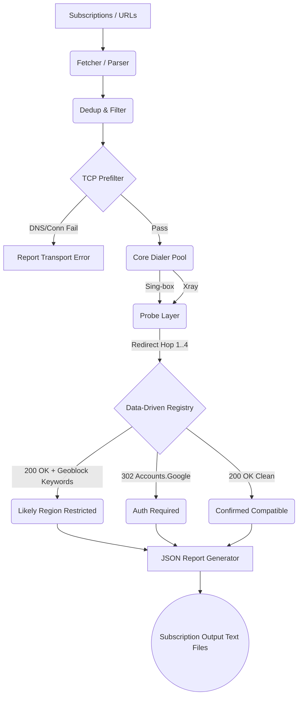

# Gemini NodeGuard

[](https://goreportcard.com/report/github.com/pouriyaahmadii/gemini-nodeguard)
[](https://opensource.org/licenses/MIT)

**Gemini NodeGuard** is an extensible, privacy-first, zero-dependency Go CLI tool designed to intelligently route and test proxy subscriptions (VLESS, VMess, Trojan, Shadowsocks, Hysteria2) specifically against Google Services endpoints (like Gemini, AI Studio, and NotebookLM) that heavily utilize IP Geoblocking and rate-limiting.

It natively spawns proxy cores (Sing-box and Xray) and evaluates exact application-layer behavior via simulated Google authentication browser footprints.

[**📖 راهنمای فارسی (Persian README)**](docs/README.fa.md)

---

## The Threat Model (Privacy First)
This tool parses your private subscription links. We believe testing tools should not silently export your nodes to developers.

* **Secrets stay Secret:** The pipeline explicitly redacts URLs locally via standard parsing before errors or diagnostic fields are logged.
* **Per-Fork Automation:** We provide out-of-the-box GitHub actions. You fork the repository and provide your subscriptions as encrypted GitHub Secrets.
* **Zero Commit Footprint:** The GitHub Actions pipeline never commits reports back. All valid nodes are uploaded safely into your personal **Secret Gist** or delivered via `age`-encrypted artifacts.

For a full guide on deploying your own automated checker, read the [Fork & Privacy Guide](docs/FORK_GUIDE.md).

---

## How It Works (Architecture)



### Protocol Support Matrix

| Protocol | Security | Obfuscation/Transport | Note |
|---|---|---|---|
| **VLESS** | TLS, Reality, None | TCP, WS, gRPC | Full WS early-data (`ed`) support |
| **VMess** | TLS, None | TCP, WS, gRPC | Parses legacy `type=http` mappings |
| **Trojan** | TLS, None | TCP, WS, gRPC | |
| **Shadowsocks** | None | TCP | Full parsing for SIP002 Base64 |
| **Hysteria2** | TLS | TCP (UDP emulated) | Auto-mapped only to Sing-Box dialer |

*Note: Shadowsocks `plugin` fields will be parsed, but they are flagged as inconclusive and skipped rather than generating broken configurations.*

---

## Installation & Usage

**Via Static Binary**
Download the pre-compiled binary from the [Releases](#) page.

```bash
nodeguard -sub "https://subscription.url" -report report.json -out-dir ./output
```

**From Source**
```bash
go build -o nodeguard ./cmd/checker
```

### CLI Flags

| Flag | Default | Description |
|---|---|---|
| `-sub` | `""` | Comma-separated subscription URLs. |
| `-sub-file` | `""` | File containing one URL per line (supports `-` for stdin). |
| `-services` | `"search,gemini,..."`| Comma-separated list of services to test. |
| `-concurrency` | `auto` | Bounded worker count for concurrent probes. |
| `-max-nodes` | `0` | Cap execution to a random reservoir sample of N nodes. |
| `-seed` | `time` | Deterministic seed for reservoir sampling. |
| `-report` | `""` | Output path for the structured JSON report. |
| `-selftest` | `false` | Run an in-memory mock pipeline for verification. |

### Structured Reports

The `-report report.json` flag generates an easily parsable run summary:

```json
{
  "version": "v1",
  "total_fetched": 1500,
  "total_parsed": 800,
  "total_alive": 12,
  "services": {
    "gemini": 4
  },
  "nodes": [
    {
      "url": "vless://server.com",
      "protocol": "vless",
      "prefilter_state": "passed",
      "services": {
        "gemini": {
          "classification": "confirmed_compatible",
          "http_status": 200,
          "latency": 340000000
        }
      }
    }
  ]
}
```

## Advanced: Custom Probes

You can define custom evaluation logic natively using the internal registry data structure. Schema constraints are fully documented inside [docs/custom-registry.example.json](docs/custom-registry.example.json).

## License

MIT License. See [LICENSE](LICENSE).
